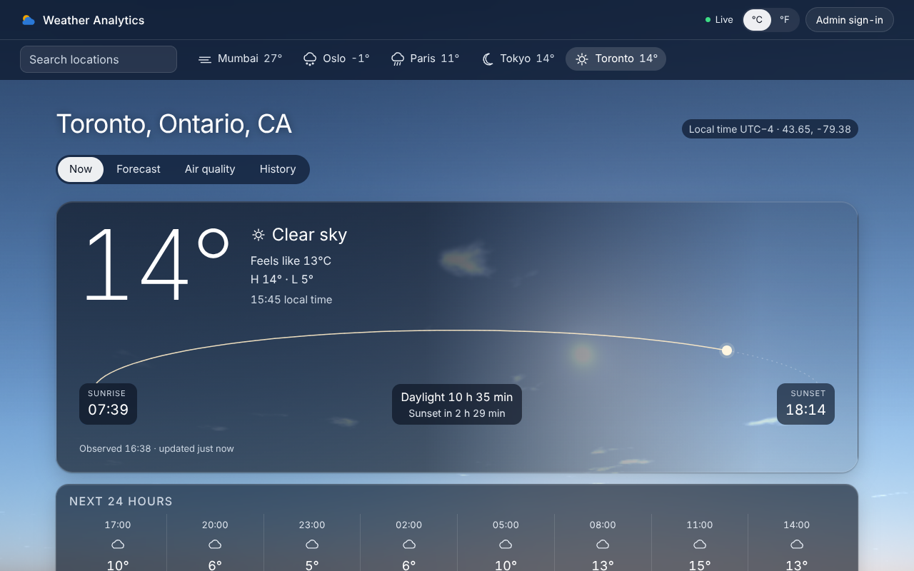
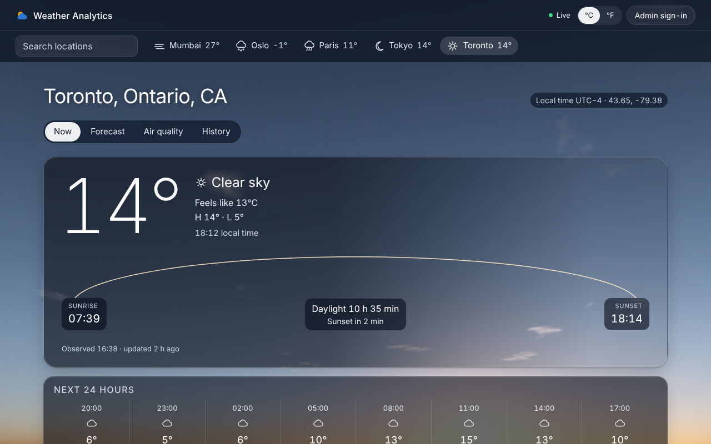
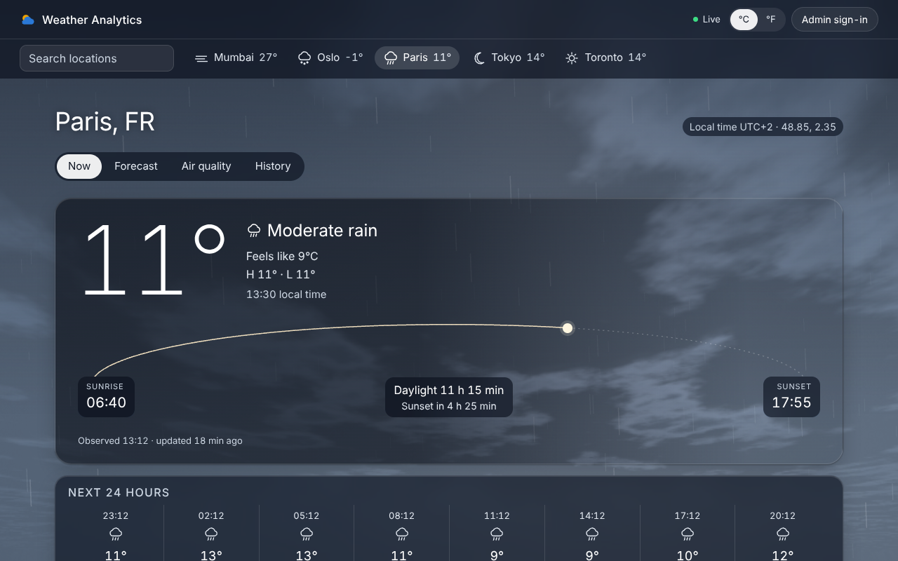
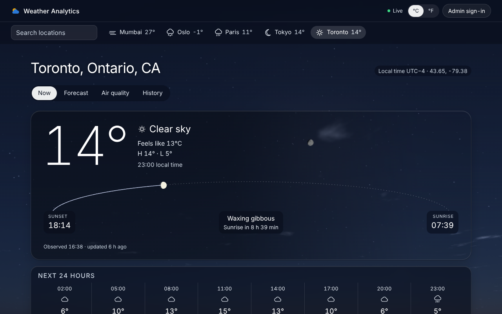
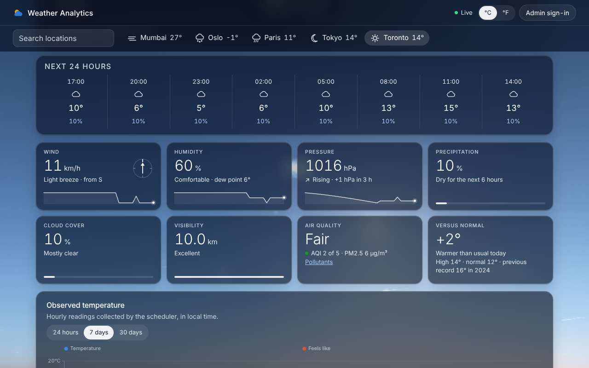
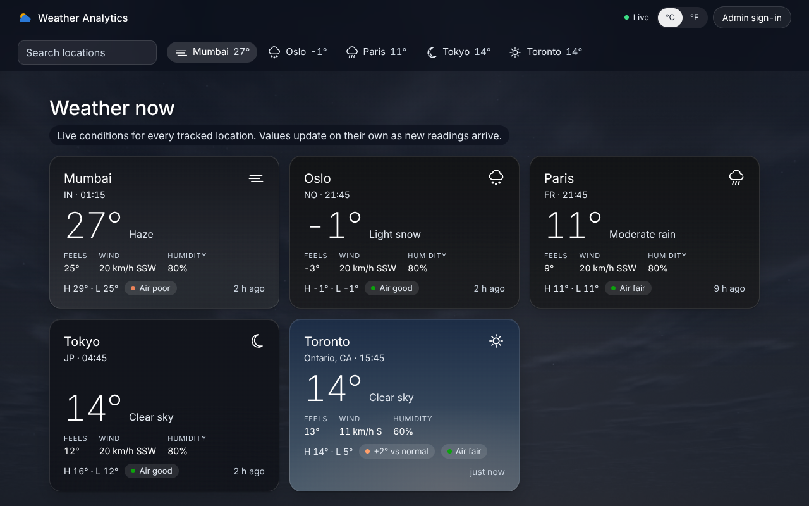

# Weather Analytics Dashboard

[](https://github.com/Vishesh-Gupta/weather-dash/actions/workflows/ci.yml)

Track locations and explore their weather: current conditions, 5-day forecasts and air quality
collected from OpenWeather on a schedule, plus years of daily history from the Open-Meteo archive.
Built to be hosted publicly: visitors browse, and only the admin manages what is tracked.








## Features

- **Live**: pages update on their own within seconds of new data being collected, with a live
  status indicator, ticking local clocks and "updated … ago" labels
- **A real sky**: the background is a physically based rendering of the viewed location's sky
  right now. The sun and moon sit where they really are (from the location's coordinates and
  the time), the atmosphere scatters their light as real air does (blue at noon, orange at
  sunset, twilight after it), and the moon is lit from the sun's true direction, so its phase and
  tilt match what you'd see. Clouds follow the reported cover and drift with the wind; overcast,
  rain, snow, fog, haze and lightning follow the observation. Motion is limited to what you'd
  see out of a window, and the sky holds still for visitors who prefer reduced motion
- **Sunrise and sunset**: an arc across the conditions panel with the sun's progress, day length
  and a countdown; after dark, the moon's phase and the time to sunrise
- **One click or search away**: every location in a strip at the top with its live temperature,
  plus search (admins can jump straight to adding an untracked place)
- **Overview**: every location as a card showing its own current sky, with feels-like, wind,
  humidity, today's range, air quality and how today compares with normal
- **Now**: current conditions, the next 24 hours, and an instrument for each reading that says
  what it means: wind on the Beaufort scale with a direction dial, humidity with dew point and
  how it feels, the 3-hour pressure tendency, rain or snow now or the chance in the next 6 hours,
  cloud cover and visibility in words, air quality, and today against the climate normal and
  record. Each shows a 24-hour trend line or meter and highlights briefly when live data changes
  it. Plus an observed temperature trend (24 hours to 30 days)
- **Forecast**: daily summary table plus 3-hourly temperature, chance of precipitation and rain/snow amounts
- **Air quality**: OpenWeather AQI level, pollutant breakdown and PM2.5/PM10 trend
- **History**: up to 5 years of daily data backfilled from Open-Meteo, with extremes, monthly
  precipitation, a sortable data table and CSV export
- Times shown in each location's local time; metric or imperial units, remembered per browser
- **Public mode**: read-only for visitors, password-protected admin for adding/removing locations
  and triggering collection
- Accessible charts (labelled, keyboard navigable, never color-only) and a responsive layout

## Architecture

```
┌─────────────┐   /api/*    ┌──────────────────────┐        ┌────────────┐
│  React SPA  │ ──────────▶ │  FastAPI (src/api)   │ ─────▶ │ PostgreSQL │
│ (frontend/) │ ◀────────── │  + serves the SPA    │        │ (SQLite in │
└─────────────┘    JSON     └──────────────────────┘        │  local dev)│
                                                            └─────▲──────┘
                            ┌──────────────────────┐              │
                            │ Scheduler            │ ─────────────┘
                            │ (src/data_collection)│ ◀── OpenWeather, Open-Meteo
                            └──────────────────────┘
```

- **Frontend**: React 19 + TypeScript (Vite), TanStack Router, Query, Table and Charts. API types
  are generated from the backend's OpenAPI schema. The sky is a WebGL 2 shader (single
  Rayleigh/Mie scattering, procedural clouds) with a CSS gradient from the same colour model
  where WebGL isn't available. It matches the machine: it draws at the display's refresh rate
  (120 Hz on a 120 Hz screen), sharpens towards full device pixels while the GPU has headroom
  (measured with GPU timer queries where the browser offers them), softens or slows down when
  it doesn't, and pauses in background tabs.
- **API**: FastAPI with Pydantic models; serves the built frontend from the same origin.
- **Scheduler**: collects current conditions, air quality and forecasts for every tracked location
  on their own intervals, and refreshes history daily.
- **Live updates**: the API watches for newly collected data and pushes it to open browsers over
  Server-Sent Events (`/api/events`), so pages update without reloading.
- **Database**: SQLAlchemy models; PostgreSQL in Docker, SQLite for local development.

## Quick start (Docker)

Prerequisites: Docker with Compose, and a free [OpenWeather API key](https://openweathermap.org/api).

```bash
git clone https://github.com/Vishesh-Gupta/weather-dash.git
cd weather-dash
cp .env.example .env          # then set WEATHER_API_KEY
docker compose up -d --build
```

Open http://localhost:8000, choose **Manage**, search for a city and track it. Its current data is
collected immediately and its history is backfilled; the scheduler keeps it up to date.

Services: `app` (web app and API on port 8000), `scheduler` and `postgres`.

```bash
docker compose logs -f app        # or scheduler
docker compose down               # stop (add -v to delete the database)
```

## Configuration

Set these in `.env` (see [`.env.example`](.env.example)):

| Variable | Default | Purpose |
|---|---|---|
| `WEATHER_API_KEY` | | OpenWeather key (required to collect data) |
| `ADMIN_PASSWORD` | unset | Enables public mode: visitors are read-only, admin signs in to manage |
| `SESSION_SECRET` | random per start | Signs admin session cookies; set it so sign-ins survive restarts |
| `SESSION_COOKIE_SECURE` | `false` | Set `true` when served over HTTPS |
| `CURRENT_INTERVAL_MINUTES` | `5` | How often to collect current conditions |
| `AIR_QUALITY_INTERVAL_MINUTES` | `30` | How often to collect air quality |
| `FORECAST_INTERVAL_MINUTES` | `60` | How often to collect the 5-day forecast |
| `APP_PORT` | `8000` | Host port for the web app |
| `POSTGRES_USER` / `POSTGRES_PASSWORD` / `POSTGRES_DB` | `weather_*` | Database credentials |
| `DATABASE_URL` | | Full SQLAlchemy URL; overrides the `POSTGRES_*` values |

`config.yaml` holds tuning such as the OpenWeather request delay and how many years of history to
backfill.

### Hosting publicly

Set `ADMIN_PASSWORD` (a long random value), `SESSION_SECRET`, and `SESSION_COOKIE_SECURE=true`, and
put the `app` service behind a TLS-terminating reverse proxy that doesn't buffer `text/event-stream`
responses (Caddy and nginx both honour the `X-Accel-Buffering: no` header the API sends). Postgres is
only bound to localhost.
Without `ADMIN_PASSWORD` anyone who can reach the site can add locations and spend your API quota.

## Development

Requires Python 3.13 with [uv](https://docs.astral.sh/uv/), Node 24 with pnpm, and
[just](https://github.com/casey/just).

```bash
just install      # Python and frontend dependencies
just api          # API on :8000 (SQLite at data/weather.db unless POSTGRES_HOST/DATABASE_URL is set)
just web          # frontend on :5173 with hot reload, proxying /api to :8000
just scheduler    # collection loop (needs WEATHER_API_KEY)
just check        # lint, typecheck and all tests, as CI runs them
```

After changing API models or routes, run `just openapi` to regenerate `openapi.json` and the
frontend's TypeScript types; CI fails if they are out of date.

Backend tests run on SQLite by default; set `TEST_DATABASE_URL` to run them against PostgreSQL.

## API

Interactive docs are served at `/api/docs`. Values are metric and timestamps UTC; each location
includes `utc_offset_seconds` for local time.

| Method | Path | Access |
|---|---|---|
| GET | `/api/health` | public |
| GET | `/api/locations`, `/api/locations/{id}` | public |
| GET | `/api/locations/{id}/current`, `/observations?days=`, `/forecast`, `/air-quality?days=`, `/history?start=&end=` | public |
| GET | `/api/locations/{id}/normals?start=&end=` | public |
| GET | `/api/overview` (every location's latest conditions) | public |
| GET | `/api/events` (Server-Sent Events: `ready`, `data`, `locations`) | public |
| GET | `/api/collection-runs/latest` | public |
| GET / POST / DELETE | `/api/session` (read, sign in, sign out) | public |
| GET | `/api/geocode?q=` | admin |
| POST | `/api/locations`, `/api/collection-runs` | admin |
| DELETE | `/api/locations/{id}` | admin |

When `ADMIN_PASSWORD` is set, admin endpoints require signing in through `POST /api/session`, which
sets an HTTP-only, `SameSite=Strict` session cookie. Failed sign-ins are rate limited.

## Data sources

- Current weather, forecasts, air quality and geocoding: [OpenWeather](https://openweathermap.org/)
- Historical daily weather: [Open-Meteo](https://open-meteo.com/) (CC BY 4.0)

## License

[MIT](LICENSE)
